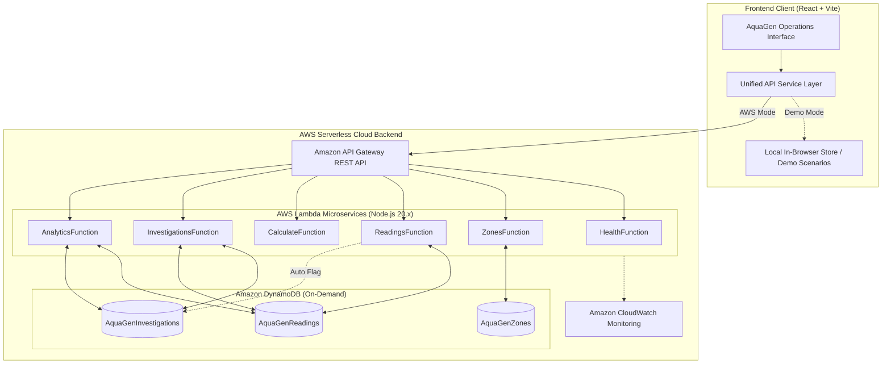

# AquaGen: The Water Black Box
> **"Trace every drop. Investigate every discrepancy."**

[](#testing)
[](#aws-serverless-architecture)
[](#technology-stack)
[](#license)

---

## 1. Executive Summary & Problem Statement

Municipal and regional water utilities face a multi-million-dollar challenge: **accounting for treated water once it enters distribution networks**. 

Water supplied, customer billing meters, storage reservoir levels, and documented outflows (such as fire testing or pipe scouring) are recorded by disparate, uncoordinated systems. When these figures do not balance, the difference is often prematurely diagnosed as physical underground pipe leakage. This results in costly, unneeded excavations when the true cause may simply be meter calibration drift, unauthorized unbilled consumption, telemetry dropouts, or reservoir transducer errors.

**AquaGen functions as the flight recorder ("The Water Black Box") for water distribution grids.** It tracks mass conservation across District Metered Areas (DMAs), isolates unexplained discrepancies, guides operators through structured investigation triage, and scientifically verifies corrective actions before and after repairs.

### Foundational Scientific Principle
> **An unexplained discrepancy is a signal for investigation, not automatic proof of physical leakage.**
> Hypotheses remain unverified until corroborated by field inspection evidence (acoustic listening, step testing, or physical excavation).

---

## 2. Key Features

- **Transparent Water-Balance Engine**: Strict mass conservation arithmetic with interactive step-by-step breakdown modals.
- **Bi-Directional Reservoir Storage ΔS**: Mathematically distinguishes tank filling ($+\Delta S$) from tank draining ($-\Delta S$), ensuring reservoir water released into the network is properly credited.
- **Data Quality & Guardrails**: Distinguishes true zero ($0$ L/day) from missing/corrupt sensor data. Holds definitive calculation when critical data points are absent.
- **Investigation & Prioritization Engine**: Assigns deterministic priority levels (Critical, High, Medium, Low) based on magnitude, multi-day persistence, telemetry completeness, and critical corridor status—with transparent, human-readable rationales.
- **Before-and-After Verification**: The core differentiating audit tool. Pairs pre-intervention water readings with post-repair readings, calculates volumetric and percentage recovery, graphs the delta, and includes scientific caveats.
- **Instant Demo Mode**: Includes 6 pre-configured operational scenarios running 100% in-browser without requiring AWS credentials or external APIs.
- **Production AWS Serverless Backend**: Complete AWS SAM template and Lambda handlers ready for deployment with Amazon API Gateway and Amazon DynamoDB.

---

## 3. Architecture



---

## 4. The Governing Water-Balance Equation

AquaGen enforces the standard physical conservation of mass equation:

$$\text{Unexplained Difference} = \text{Water Supplied} - \text{Recorded Consumption} - \Delta S - \text{Other Documented Outflows}$$

Where:
- $\text{Water Supplied}$: Bulk transmission inflow into the DMA (L/day).
- $\text{Recorded Consumption}$: Aggregated smart billing meters and AMR telemetry (L/day).
- $\Delta S$: Net storage change in reservoir tanks (L/day).
  - If reservoir **filled**, $\Delta S > 0$ (water accounted for in storage; subtracted from available supply).
  - If reservoir **drained**, $\Delta S < 0$ (water released from tank into customer taps: $- (-\Delta S) = + |\Delta S|$ added to available supply).
- $\text{Other Documented Outflows}$: Authorized non-metered usage (hydrant flushing, fire service tests).

### Discrepancy Percentage
$$\text{Discrepancy } \% = \left( \frac{\text{Unexplained Difference}}{\text{Total Available Supply}} \right) \times 100$$
Where $\text{Total Available Supply} = \text{Water Supplied} + (\Delta S < 0 ? |\Delta S| : 0)$.

---

## 5. Technology Stack

- **Frontend**: React 18, Vite 5, JavaScript (ES Modules), Responsive Vanilla CSS Design System, Recharts, Lucide React.
- **Testing**: Vitest (23 automated unit tests).
- **Backend**: AWS Lambda (Node.js 20.x runtime), Amazon API Gateway, Amazon DynamoDB (On-Demand billing mode), Amazon CloudWatch.
- **Infrastructure-as-Code**: AWS SAM (`template.yaml`).

---

## 6. Pre-Built Demo Scenarios

AquaGen includes a live scenario switcher at the top of the application to demonstrate realistic utility situations:

| Scenario | Scenario Key | Description | Key Focus |
|---|---|---|---|
| **Normal Water Balance** | `NORMAL` | Baseline operation across all 3 zones. Discrepancy is $<3.0\%$, well within expected metering tolerance. | Healthy network baseline |
| **Large Unexplained Discrepancy** | `LARGE_DISCREPANCY` | Acute $28,000$ L/day ($25.5\%$) discrepancy in North Hill with high night minimum flow. | Immediate acoustic crew dispatch |
| **Possible Meter Fault** | `METER_FAULT` | Central Metro recorded consumption abruptly drops by $34,700$ L/day while grid pressure remains steady. | AMR collector antenna failure |
| **Missing Telemetry Data** | `MISSING_DATA` | Riverside Industrial reservoir sensor communication dropout. Calculation engine holds computation rather than creating a false alert. | Data quality guardrail |
| **Persistent Multi-Day Loss** | `PERSISTENT_LOSS` | North Hill exhibits elevated discrepancy over 4 consecutive days, escalating triage priority to Critical. | Persistence triage engine |
| **Before-and-After Verification** | `BEFORE_AFTER` | Verification of $150\text{mm}$ main joint repair: discrepancy drops from $23,500$ L/day down to $2,400$ L/day ($89.8\%$ verified recovery). | Post-repair audit & chart |

---

## 7. Local Setup & Quick Start

### Prerequisites
- Node.js 18+ (tested on Node v20/v24)
- npm or pnpm

### 1. Clone & Install
```bash
git clone https://github.com/your-org/aquagen-water-black-box.git
cd aquagen-water-black-box
npm install
```

### 2. Run Automated Unit Tests
```bash
npm test
```
*Expected: 23 passed unit tests verifying water balance equations, storage draining, input validations, duplicate checks, prioritization, and before-and-after calculations.*

### 3. Run Locally in Development Mode
```bash
npm run dev
```
Open [http://localhost:3000](http://localhost:3000) in your browser. The application runs immediately in **Local Demo Mode** with simulated utility datasets.

### 4. Build for Production
```bash
npm run build
```

---

## 8. AWS Serverless Backend Deployment

AquaGen provides an AWS SAM template ready for serverless deployment.

### Prerequisites for AWS Deployment
- AWS CLI configured with valid credentials (`aws configure`)
- AWS SAM CLI installed (`sam --version`)

### Step 1: Review Infrastructure Template
Inspect [template.yaml](template.yaml) which defines:
- 3 Amazon DynamoDB Tables (`AquaGenZones`, `AquaGenReadings`, `AquaGenInvestigations`) with pay-per-request billing (zero cost when idle).
- 6 AWS Lambda Functions with least-privilege IAM policies.
- Amazon API Gateway with open CORS headers.

### Step 2: Build with AWS SAM
```bash
sam build
```

### Step 3: Deploy to AWS
```bash
sam deploy --guided
```
Prompt responses:
- **Stack Name**: `aquagen-backend`
- **AWS Region**: `us-east-1` (or your preferred region)
- **Confirm changes before deploy**: `Y`
- **Allow SAM CLI to create IAM roles**: `Y`
- **Disable authorization for demonstration endpoints**: `Y`

SAM will output your API Gateway URL:
```text
Key: ApiEndpoint
Value: https://abc123xyz.execute-api.us-east-1.amazonaws.com/Prod
```

### Step 4: Connect the Frontend
Create or edit `.env` in the project root:
```env
VITE_API_URL=https://abc123xyz.execute-api.us-east-1.amazonaws.com/Prod
```
Re-run `npm run dev` or switch the toggle in the UI:
1. Click the **"Local Demo Mode"** pill in the top navigation.
2. Enter your API Gateway URL.
3. Click **"Test AWS Endpoint"** to verify `/health`.
4. Click **"Switch to AWS Connected Mode"**.

### Step 5: Clean Up AWS Resources (Teardown)
To completely delete all AWS resources and avoid unintended charges:
```bash
sam delete --stack-name aquagen-backend
```

---

## 9. API Reference

All endpoints return JSON and include standard CORS headers (`Access-Control-Allow-Origin: *`).

| Method | Endpoint | Description |
|---|---|---|
| `GET` | `/health` | Health check endpoint returning API version and status. |
| `GET` | `/zones` | Returns all water supply zones / DMAs. |
| `GET` | `/zones/{zoneId}` | Returns specific zone metadata by ID. |
| `GET` | `/readings` | Returns water readings. Optional query params: `?zoneId=Z-NORTH`. |
| `POST` | `/readings` | Logs a daily reading, calculates mass balance, and creates an investigation if discrepancy exceeds threshold. |
| `POST` | `/readings/calculate` | Pure calculation endpoint: validates input and returns balance breakdown without storing. |
| `GET` | `/investigations` | Returns all discrepancy investigation records. |
| `POST` | `/investigations` | Creates a new investigation case. |
| `GET` | `/investigations/{id}` | Fetches investigation details and evidence log. |
| `PATCH` | `/investigations/{id}` | Updates case status (`Open`, `Under Review`, `Inspection Required`, `Resolved`, `Inconclusive`). |
| `POST` | `/investigations/{id}/inspections` | Adds a field inspection note to the investigation. |
| `POST` | `/investigations/{id}/verify-comparison` | Associates pre/post readings to calculate and chart verified recovery. |
| `GET` | `/analytics/summary` | Returns aggregated metrics across active filters. |

### Sample Payload: POST /readings
```json
{
  "zoneId": "Z-NORTH",
  "date": "2026-10-10",
  "waterSupplied": 100000,
  "recordedConsumption": 72000,
  "storageChange": 8000,
  "otherDocumentedOutflows": 0,
  "notes": "Diurnal balance reading."
}
```

### Sample Response:
```json
{
  "reading": {
    "id": "RD-Z-NORTH-M3X...",
    "unexplainedDifference": 20000,
    "discrepancyPercentage": 20.0,
    "classification": "HIGH_DISCREPANCY",
    "severity": "HIGH"
  },
  "balance": {
    "isComputable": true,
    "unexplainedDifference": 20000,
    "discrepancyPercentage": 20.0
  },
  "createdInvestigation": {
    "id": "INV-2026-4821",
    "priority": "High"
  }
}
```

---

## 10. Cost & Security Considerations

- **Serverless Free Tier**: Built entirely on AWS Lambda, API Gateway HTTP/REST, and DynamoDB on-demand mode. For demonstration volumes (<10,000 requests/month), operational AWS cost is **$0.00**.
- **No Costly AI APIs**: All prioritization logic and water-balance equations are deterministic and mathematically rigorous, avoiding variable per-token API costs.
- **Zero Hardcoded Secrets**: Secrets are never hardcoded. No AWS keys are bundled into frontend static assets.
- **Billing Awareness Note**: AWS CloudWatch billing alerts are notifications, not hard spending limits. Always run `sam delete` when demonstration concludes.

---

## 11. Short Hackathon Demo Script (3-Minute Tour)

1. **The Hook (0:00 - 0:45)**:
   - Introduce AquaGen as "The Water Black Box" for municipal distribution grids.
   - Point out the core equation: $\text{Supplied} - \text{Consumed} - \Delta S - \text{Outflows} = \text{Discrepancy}$.
   - Open the **Audit Arithmetic** modal on the Dashboard to showcase transparent arithmetic and storage decrease handling.
2. **The Investigation Workflow (0:45 - 1:45)**:
   - Select Scenario 2: **"Large Unexplained Discrepancy"**.
   - Show how the KPI cards turn red ($28,000$ L/day, $25.5\%$).
   - Click into Case `INV-2026-0104`. Show the **Working Hypotheses** and explain that AquaGen does not jump to calling it a physical leak without evidence.
   - Show the logged acoustic inspection notes pinpointing the fracture on Pine Avenue.
3. **The Differentiating Closer: Before-and-After Verification (1:45 - 2:30)**:
   - Showcase the **Before-and-After Verification** chart in `INV-2026-0104`.
   - Explain how linking post-repair reading verified an $89.8\%$ discrepancy reduction ($21,100$ L/day saved).
   - Point out the scientific disclaimer: improvement is evidence of operational change, not sole physical proof.
4. **Data Quality & AWS Architecture (2:30 - 3:00)**:
   - Switch to **"Missing Telemetry Data"** scenario. Show the Data Quality Audit page and demonstrate how missing storage readings suspend calculations to prevent false alarms.
   - Open the **Backend Mode** modal to demonstrate the AWS SAM serverless architecture.

---

## 12. Recommended Demonstration Screenshots

1. **Dashboard Overview**: KPI cards, mass conservation trend area chart, and zone summaries.
2. **Transparent Arithmetic Modal**: Step-by-step arithmetic evaluation showing how storage change is computed.
3. **Investigation Detail & Hypotheses**: Priority rationale banner and working hypothesis cards.
4. **Before-and-After Verification**: Post-repair comparative bar chart and recovery metrics.
5. **Data Quality Audit**: Sensor health matrix and telemetry dropout alert.

---

## 13. License

MIT License. Developed for water utility intelligence and conservation demonstration.

# Bharat-Builds-Tour
